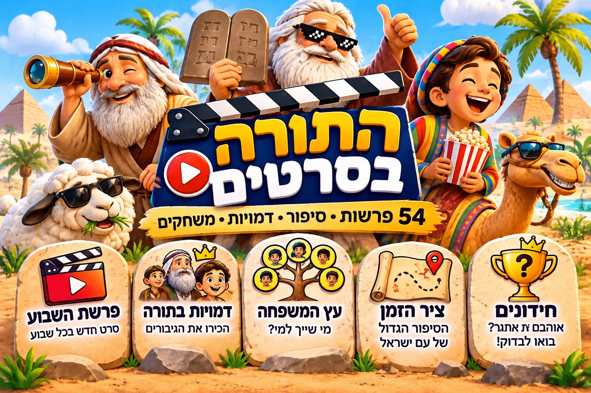

# Torah Bollag — תורה בקומיקס

Bandes dessinées pour enfants à partir des enseignements de Bollag. Hébreu simple avec nikoud.

## Sommaire des parachiot

| Livre | Paracha | Épisodes |
|---|---|---|
| בראשית — Bereshit | [05 · חיי שרה — ‘Hayé Sarah](parachiot/01-bereshit/05-chaye-sarah/README.md) | 2 et 3 novembre 2026 |

## Encyclopédie des personnages

[encyclopedie.html](encyclopedie.html) relie trois espaces : **פרשת השבוע** (l’épisode de la semaine), **ציר הזמן** (la frise) et **דמויות בתורה** (fiches et arbres). Hébreu RTL par défaut, bouton Français.

- Données : `data/personnages.json`, une seule source pour la frise, les fiches et les arbres. Chaque personnage a un identifiant permanent, ses relations avec le verset, ses parachiot, ses dates et leur origine (texte, Rachi/Midrash, adaptation).
- Portraits : `assets/portraits.js` est une copie exacte du dessin utilisé dans les épisodes. Un personnage sans portrait garde une silhouette ; aucun visage n’est inventé.
- Vidéos : champ `video` par personnage (URL d’un hébergement média externe). Tant qu’il est vide, la fiche affiche « vidéo en préparation ».
- Contenu : tout Sefer Bereshit (84 personnages, 285 questions, un arbre par paracha, un portrait par personnage).
- Rythme : les épisodes avancent d’une paracha par semaine, mise à jour chaque jeudi. Paracha de la semaine : חיי שרה.

## Organisation

Les contenus sont classés dans l’ordre de la Torah : **livre → paracha → date du texte → planches numérotées**.

Les prochaines parachiot seront ajoutées lorsqu’un enseignement correspondant sera reçu. Chaque épisode garde ses textes et ses images ensemble.

## État actuel

Le classement des deux premiers épisodes est créé. Les images ne sont pas encore ajoutées.

[Consignes éditoriales](docs/ligne-editoriale.md)
